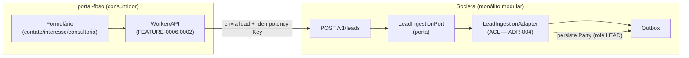
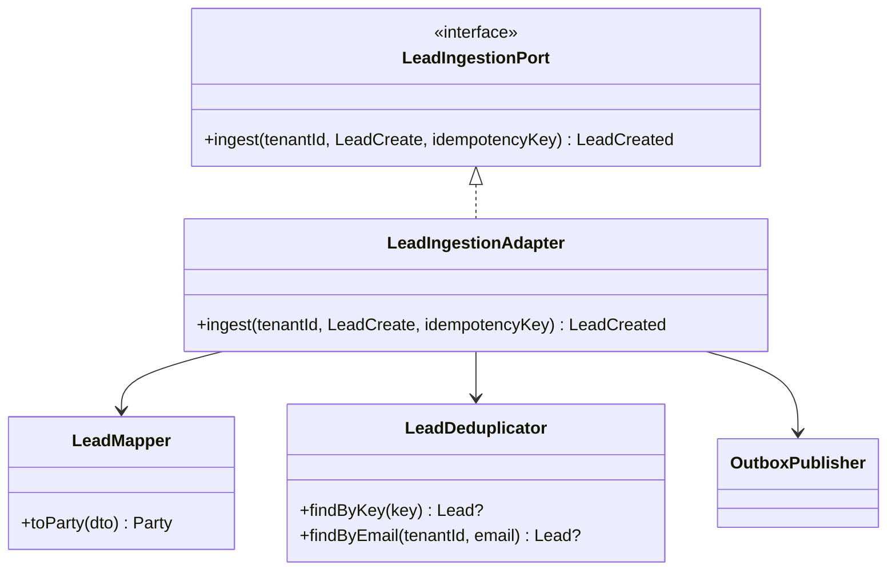
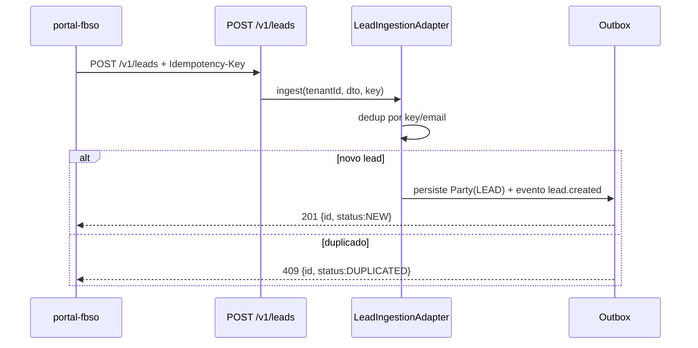

# 🔌 Integração — Ingestão de Leads (portal → Sociera)

| Campo | Valor |
|---|---|
| **Responde** | FEATURE-0009.0001 (contrato de solução) — [card](../../../../projects/PRJ-CORP-2026-0000-CRM/prj-produto/features/FEATURE-0009.0001-contrato-solucao-lead.md) |
| **Requisitos** | B-REQ-06 (receber leads do portal automaticamente) |
| **Decisão** | [ADR-001 (estratégia de integrações)](https://github.com/fbso-techsolutions/platform-standards/blob/main/governance/adrs/adr-001-estrategia-integracoes.md) — contrato de solução (OpenAPI + SDK + webhook) · [ADR-004 (ACL + Outbox)](https://github.com/fbso-techsolutions/platform-standards/blob/main/standards/architecture/guardrail-eventos-outbox.md) |
| **Contrato** | [openapi-ingestao-leads.yaml](contratos/openapi-ingestao-leads.yaml) |
| **Dono** | Eng (Thiago Daniel) + PM/PO (Marcela Bianco) |
| **Consumido por** | [portal-fbso FEATURE-0006.0003](https://github.com/fbso-techsolutions/portal-fbso) (envio de leads) |
| **Status** | 📝 **PROPOSTA (0.2.0)** — payload, dedup, tenant e endpoints decididos (§7); URL base/escopos a confirmar com o Arquiteto |

## 1. Objetivo e escopo (integração unidirecional)

- **Entrada (síncrona/assíncrona):** o portal envia um lead (`POST /v1/leads`) e o Sociera o
  persiste como Party (role `LEAD`) com origem de aquisição (`source`/`medium`/`campaign`) e
  consentimento LGPD. Idempotente via `Idempotency-Key` (dedup de reenvio).

## 2. Visão da integração

## 3. Componentes (ACL)

## 4. Fluxo — ingestão de lead

## 5. Contrato

- **`POST /v1/leads`** com header **`Idempotency-Key`** (obrigatório) e corpo `LeadCreate`
  (`name`, `email`, `interest`, `consent`, `consent_version`, `consent_timestamp` obrigatórios;
  `phone`, `company`, `tax_id`, `company_size`, `role`, `message`, UTMs completos, `ip_address`
  opcionais).
- **Semântica de idempotência:** mesma `Idempotency-Key` (retry) → **200** com o lead original ·
  nova chave + email já existente no tenant → **409** · primeira vez → **201**.
- **Multi-tenancy:** o `tenant_id` vem das **claims do token JWT** (Keycloak) — nunca de
  header/parâmetro (explícito na descrição do securityScheme).
- **Leitura (dono do domínio de Leads):** `GET /v1/leads` (listar com filtros/paginação) e
  `GET /v1/leads/{leadId}` (detalhar) — uso interno do CRM (Bearer).
- **Evento de saída:** `lead.created` (versionado) — alimenta auditoria e futuras integrações.

## 6. Resiliência e erros

| Situação | Resposta |
|---|---|
| Reenvio com mesma `Idempotency-Key` (retry) | **200** com o lead original (não duplica) |
| Nova chave + email já existente no tenant | **409** `DUPLICATED` (dedup) |
| Consentimento `false`/sem evidência (version/timestamp) | 400 (LGPD) |
| Sociera indisponível | portal registra pendência + retry |
| Falha no processamento | Outbox reentrega (at-least-once, consumidor idempotente) |

**Dedup:** chave primária = `email` por tenant; telefone normalizado em E.164 (não é chave de
dedup isolada no MVP — evita falso-positivo de leads que compartilham número).

## 7. Pendências de fechamento

1. ✅ **Campos do lead** — decidido: payload enriquecido (UTMs completos, evidência LGPD
   `consent_version`/`consent_timestamp`/`ip_address`, qualificação B2B `tax_id`/`company_size`/`role`).
2. ✅ **`interest`** — catálogo canônico: `EDUCACAO` · `CONTABILIDADE` · `VAREJO` ·
   `ECONOMIA_CIRCULAR` · `CRM` · `CONSULTORIA`.
3. `[ ]` **URL base + escopos OAuth2** (client credentials) — com o Arquiteto (Ricardo David) e Infra.

## 8. Rastreabilidade

| Elemento | ADR/Regra | Onde vive |
|---|---|---|
| `LeadIngestionPort` (ACL) | ADR-001 · ADR-004 | §3 |
| Idempotência (`Idempotency-Key` + dedup) | ADR-004 (Outbox/idempotência) | §5, §6 |
| Evento `lead.created` (versionado) | guardrail-eventos-outbox | §5 |
| Consentimento LGPD obrigatório | PENDENCY-0019 (portal) | §5 (campo `consent`) |
